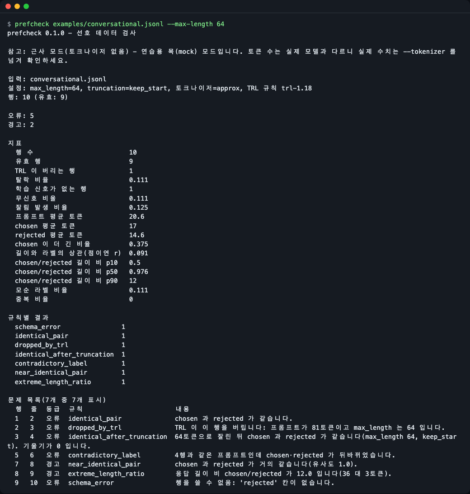
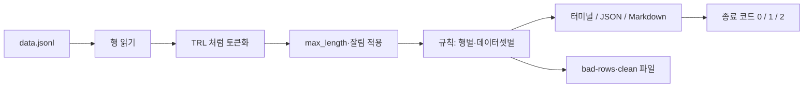
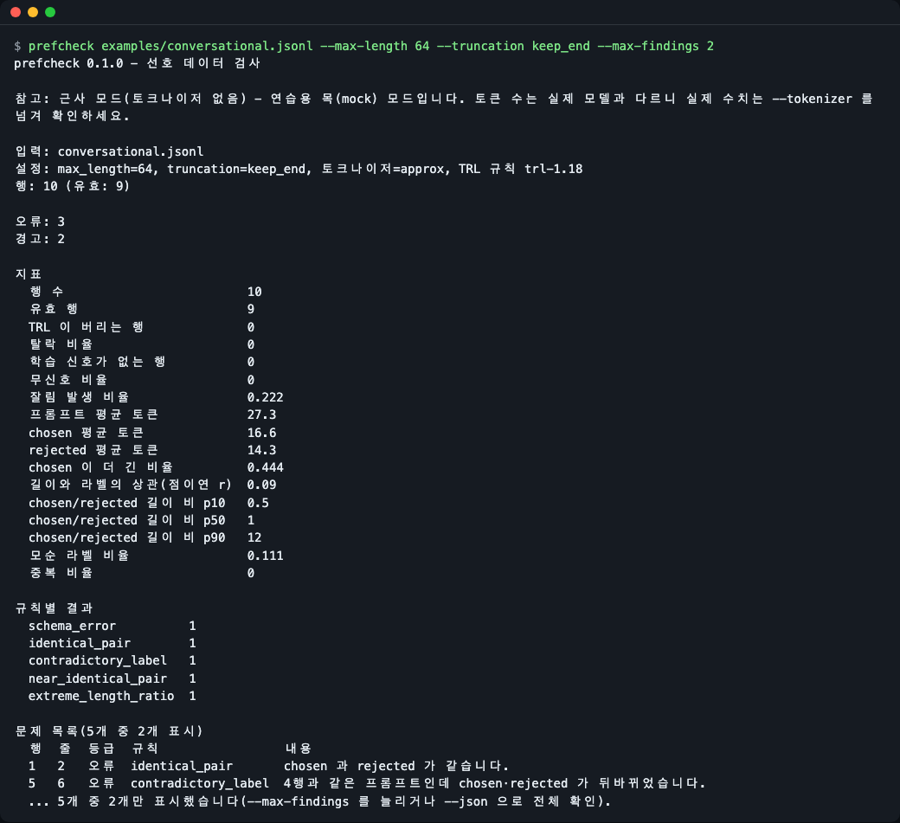
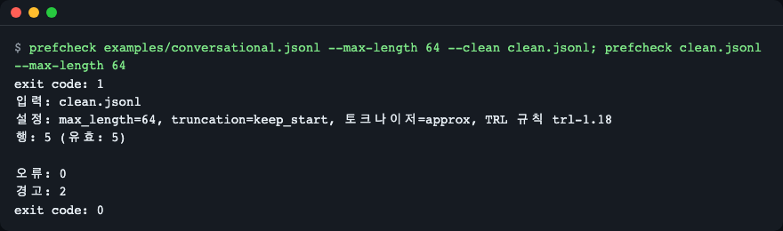
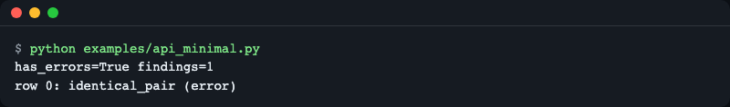

# prefcheck

[English](README.md) | **한국어**

prefcheck 는 학습을 시작하기 전에 DPO/ORPO 선호 데이터셋(JSONL 또는 JSON)을 검사하는 도구입니다. TRL 이 각 쌍을 준비하는 과정(토크나이저, 프롬프트 경계, `max_length`, 잘림)을 그대로 재현해서, 어떤 행이 조용히 버려지는지, 어떤 행이 잘린 뒤 똑같아지는지, 어떤 행이 서로 모순인지, `chosen` 이 `rejected` 보다 체계적으로 긴지를 행 번호와 함께 알려 줍니다. CLI 와 Python 라이브러리로 쓸 수 있고, 필수 의존성은 없습니다.



*동봉된 샘플 파일의 보고서입니다. 오류 5개·경고 2개가 행 번호·줄 번호와 함께 나옵니다. 이 실행은 아래에서 설명하는 연습용 목(mock) 모드입니다.*

## 설치

```bash
pip install prefcheck            # CLI + 라이브러리, 표준 라이브러리만 사용
pip install "prefcheck[hf]"      # 내 모델의 실제 토크나이저용 transformers + tokenizers 추가
```

uv 를 쓴다면 `uv tool install prefcheck`(CLI) 또는 `uv add prefcheck`(라이브러리). uv 가 없다면 `curl -LsSf https://astral.sh/uv/install.sh | sh`. 저장소에서 바로 설치하려면 `pip install "git+https://github.com/LeeGyeongPil/prefcheck"`.

Python 3.11 이상이 필요합니다. 코어는 런타임 의존성이 없습니다. `[hf]` 추가 항목은 `transformers==5.23.0`, `tokenizers==0.23.3`, `jinja2==3.1.6` 을 고정하며, PyTorch 는 필요 없습니다.

## 빠르게 시작하기

이 저장소를 clone 해서 샘플 파일로 해 봅니다(토크나이저가 필요 없는 연습용 목 모드):

```bash
git clone https://github.com/LeeGyeongPil/prefcheck && cd prefcheck
uv sync
uv run prefcheck examples/conversational.jsonl --max-length 64
```

`--tokenizer` 를 주지 않으면 단어·구두점 단위의 근사 토크나이저를 쓰므로 **연습용 목(mock) 모드**입니다. 토큰 수는 내 모델과 다릅니다. 규칙 로직(탈락, 잘림, 모순, 길이 편향)은 진짜입니다. 실제 수치는 `--tokenizer <모델 ID 또는 폴더>` 로 확인하세요.

출력의 앞부분은 이렇습니다(여기서는 줄였고, 위 스크린샷에 전체가 있습니다).

```text
prefcheck 0.1.1 - 선호 데이터 검사

참고: 근사 모드(토크나이저 없음) - 연습용 목(mock) 모드입니다. 토큰 수는 실제 모델과 다르니 실제 수치는 --tokenizer 를 넘겨 확인하세요.

입력: conversational.jsonl
설정: max_length=64, truncation=keep_start, 토크나이저=approx, TRL 규칙 trl-1.18
행: 10 (유효: 9)

오류: 5
경고: 2
```

출력 끝부분에 문제 목록 표가 있습니다(`--max-findings 3` 이면 표 뒤에 짧은 안내 줄이 하나 더 나옵니다).

```text
문제 목록(7개 중 3개 표시)
  행  줄  등급  규칙                        내용
  1   2   오류  identical_pair              chosen 과 rejected 가 같습니다.
  2   3   오류  dropped_by_trl              TRL 이 이 행을 버립니다: 프롬프트가 81토큰이고 max_length 는 64 입니다.
  3   4   오류  identical_after_truncation  64토큰으로 잘린 뒤 chosen 과 rejected 가 같습니다(max_length 64, keep_start). 기울기가 0 입니다.
```

이 실행은 `--max-findings 3` 이었고, 기본값은 최대 50개 표시입니다. 행 번호는 0부터, 줄 번호는 1부터 시작하므로 행 1 의 문제는 파일의 2번째 줄입니다. 오류가 있으므로 종료 코드는 `1` 입니다.

## 핵심 개념

1. **TRL 재현.** 각 행마다 TRL 1.18(`trl-1.18` 프로필)의 준비 단계를 따라갑니다: 암시적 프롬프트 추출, 일반 텍스트 데이터에 EOS 추가, 토큰화, 공통 토큰 접두부를 프롬프트 경계로 사용, `keep_start` 에서 프롬프트만으로 `max_length` 가 차는 행 제거, `keep_start` 또는 `keep_end` 로 응답 잘라내기. 넘기는 설정(`--max-length`, `--truncation`, `--tokenizer`)이 실제 학습처럼 결과를 바꿉니다.
2. **한 원인, 문제 하나.** 동일 쌍은 `identical_pair` 하나만, 탈락한 행은 신호 규칙을 건너뛰고, 스키마 오류 행은 나머지 규칙을 건너뜁니다.
3. **오류와 경고.** 오류는 학습을 낭비하거나 행을 못 쓰게 만드는 문제(종료 코드 1)이고, 경고는 살펴볼 만한 것(`--fail-on warn` 이 아니면 종료 코드 0)입니다. `length_bias` 같은 데이터셋 전체 규칙은 파일 전체를 설명합니다.
4. **연습 모드와 실제 모드.** 근사 토크나이저는 토큰 수만 바꿉니다. 경계 근처(`max_length` 64 에서 프롬프트 62 대 66토큰)에서는 실제 토크나이저로 다시 실행하세요.



왼쪽에서 오른쪽으로 읽습니다. 행을 학습기가 하듯 토큰화하고, 설정대로 자르고, 규칙으로 검사한 뒤, 여러 형태의 보고서와 CI 용 종료 코드로 알려 줍니다.

### 데이터 형식

세 가지 모양을 받습니다(한 줄에 한 레코드인 `.jsonl` 또는 `.json` 배열). 대화형 행은 `prompt`, `chosen`, `rejected` 가 `{"role", "content"}` 메시지 목록입니다. 표준 행은 문자열입니다. 암시적 프롬프트 행은 `chosen`, `rejected` 만 있고 둘의 공통 앞부분이 프롬프트입니다. 샘플: [`examples/conversational.jsonl`](examples/conversational.jsonl), [`examples/standard_implicit.jsonl`](examples/standard_implicit.jsonl).

## 사용법

### 명령줄

```text
prefcheck [--tokenizer NAME|PATH] [--offline] [--revision REV]
          [--max-length N|none] [--truncation {keep_start,keep_end}]
          [--config PATH] [--json PATH] [--markdown PATH]
          [--bad-rows PATH] [--clean PATH] [--fail-on {error,warn,never}]
          [--max-findings N] [--lang {en,ko}] [--list-rules] [--version]
          [-h]
          [DATA]
```

| 옵션 | 하는 일 |
|---|---|
| `DATA` | 선호 데이터 행이 든 `.jsonl` 파일 또는 `.json` 배열 |
| `--tokenizer` | Hub 모델 ID 또는 로컬 폴더(`prefcheck[hf]` 필요). 없으면 근사 연습 모드 |
| `--offline` | 토크나이저를 로컬 파일에서만 읽고, 네트워크 재시도 없이 바로 실패 |
| `--revision` | 토크나이저 브랜치·태그·커밋 |
| `--max-length N\|none` | 흉내 낼 TRL `max_length`(기본 1024) |
| `--truncation` | 흉내 낼 TRL `truncation_mode`(기본 `keep_start`, 또는 `keep_end`) |
| `--config` | 임계값과 규칙별 등급을 담은 `prefcheck.toml` |
| `--json` / `--markdown` | 기계가 읽는 보고서 또는 Markdown 보고서 저장 |
| `--bad-rows` | 오류가 있는 행 저장(원본 행 + `_prefcheck` 칸), 입력과 같은 형식(JSONL 또는 JSON 배열) |
| `--clean` | 오류 없는 행만 저장(순서 그대로), 입력과 같은 형식(JSONL 또는 JSON 배열) |
| `--fail-on` | `error`(기본), `warn`, `never`: 어떤 등급이면 종료 코드 1 인지 |
| `--max-findings N` | 터미널 표에 보일 문제 수(기본 50) |
| `--lang en\|ko` | 화면 언어(설정 절 참고) |
| `--list-rules` | 모든 규칙과 기본 등급 출력 |

종료 코드: `0` 실패 등급의 문제 없음, `1` `--fail-on` 이상의 문제 있음, `2` 사용법·입력 오류(예: 없는 파일, `prefcheck: 오류: 파일을 찾을 수 없습니다: nofile.jsonl. 경로를 확인하세요.`). 출력 경로(`--json`, `--markdown`, `--bad-rows`, `--clean`)가 입력 파일과 같으면 입력을 덮어쓰지 않도록 종료 코드 2 로 거부합니다.

### 규칙

`prefcheck --list-rules` 는 13개를 모두 보여 줍니다(따로 적지 않으면 오류).

| 규칙 | 의미 |
|---|---|
| `schema_error` | 행을 쓸 수 없음: 칸 누락, 타입 오류, 빈 텍스트, 잘못된 역할 |
| `identical_pair` | `chosen` 과 `rejected` 가 같아 선호 신호가 없음 |
| `dropped_by_trl` | `keep_start` 에서 프롬프트만으로 `max_length` 가 차서 TRL 이 행을 버림 |
| `empty_completion_after_truncation` | 잘린 뒤 응답 토큰이 남지 않음 |
| `identical_after_truncation` | 원문은 다르지만 실제로 잘린 뒤 같아짐(손실 0.693, 기울기 0). 잘림 없이 토큰만 같아지는 쌍(예: 공백만 다름)은 `near_identical_pair` 로 보고 |
| `contradictory_label` | 같은 프롬프트가 다른 행에서 `chosen`·`rejected` 가 뒤바뀐 채 나옴 |
| `prompt_not_prefix` (경고) | 토큰화한 프롬프트가 프롬프트+응답의 접두부가 아니라 프롬프트 끝이 학습에서 빠짐 |
| `near_identical_pair` (경고) | 정규화한 텍스트가 같거나 거의 같음(문자 3-gram Jaccard) |
| `extreme_length_ratio` (경고) | 응답 길이 비가 극단적이라 모델이 품질 대신 길이를 배울 수 있음 |
| `duplicate_row` (경고) | 앞 행과 프롬프트·`chosen`·`rejected` 가 완전히 같음 |
| `implicit_prompt_split` (경고) | 암시적 프롬프트를 `chosen`·`rejected` 에서 깔끔하게 나눌 수 없음 |
| `mixed_format` (데이터셋) | 형식이 섞임. TRL 은 첫 행만 보고 프롬프트 추출·EOS 처리를 정함 |
| `length_bias` (경고, 데이터셋) | `chosen` 이 `rejected` 보다 체계적으로 긺(참고 지표) |

### 파이프라인용 출력 파일

```bash
prefcheck examples/conversational.jsonl --max-length 64 \
  --json report.json --markdown report.md --bad-rows bad.jsonl --clean clean.jsonl
```

`report.json` 은 언어 중립입니다(규칙 ID·숫자, `message` 칸만 선택한 언어). 앞부분은 이렇습니다.

```json
{
  "meta": {
    "tool": "prefcheck",
    "tool_version": "0.1.1",
    "trl_rules": "trl-1.18",
    "mode": "approx",
    "tokenizer": "approx",
    "input": "conversational.jsonl"
  },
```

### Python API

```python
from prefcheck import CheckConfig, check_rows

rows = [
    {
        "prompt": [{"role": "user", "content": "What color is the sky?"}],
        "chosen": [{"role": "assistant", "content": "The sky is blue."}],
        "rejected": [{"role": "assistant", "content": "The sky is blue."}],  # 동일 쌍: 오류
    },
    {
        "prompt": [{"role": "user", "content": "Name a prime number."}],
        "chosen": [{"role": "assistant", "content": "Seven is a prime number."}],
        "rejected": [{"role": "assistant", "content": "Nine is a prime number."}],
    },
]

report = check_rows(rows, CheckConfig(max_length=64))
print(f"has_errors={report.has_errors} findings={len(report.findings)}")
for finding in report.findings:
    print(f"row {finding.row}: {finding.rule} ({finding.severity})")
```

```text
has_errors=True findings=1
row 0: identical_pair (error)
```

이 코드는 [`examples/api_minimal.py`](examples/api_minimal.py) 입니다. 파일을 읽고 잘림 방식을 바꾸는 예:

```python
from prefcheck import CheckConfig, check_file

report = check_file("examples/conversational.jsonl", CheckConfig(max_length=64, truncation_mode="keep_end"))
print(report.has_errors, report.exit_code(), len(report.findings), report.stats["dropped_by_trl"])
f = report.findings[0]
print(f.row, f.line, f.rule, f.severity)
```

```text
True 1 5 0
1 2 identical_pair error
```

`keep_end` 에서는 행 2 가 더는 버려지지 않고 행 3 도 더는 동일해지지 않아서, 문제가 7개가 아니라 5개 남습니다.

## 단계별로 해 보기

아래 명령은 `prefcheck` 만 씁니다. 빠르게 시작하기에서 받은 clone 안에서는 앞에 `uv run` 을 붙이거나 `.venv` 를 활성화하세요. `pip install` 이나 `uv tool install` 로 설치했다면 그대로 `prefcheck` 를 실행하면 됩니다.

**1. 잘림 방식 바꾸기.** 같은 파일을 `--truncation keep_end` 로 실행합니다.

```bash
prefcheck examples/conversational.jsonl --max-length 64 --truncation keep_end --max-findings 2
```



*오류가 5개에서 3개로 줄어듭니다. `keep_end` 는 시퀀스의 뒷부분을 남기므로 탈락한 행과 잘린 뒤 동일해진 행이 사라집니다. 학습 설정이 판정을 바꾼다는 것이 이 도구의 핵심입니다.*

**2. 잘림 끄기.** `--max-length none` 은 잘림과 관련된 문제를 모두 없앱니다(보고서에는 잘리는 행이 없어 `오류: 3`, `경고: 2` 가 나옵니다).

**3. CI 게이트.** 깨끗한 행만 저장한 뒤 그 파일을 검사하면 종료 코드 0 입니다.

```bash
prefcheck examples/conversational.jsonl --max-length 64 --clean clean.jsonl
echo $?   # 1: 원본에는 오류가 있음
prefcheck clean.jsonl --max-length 64
echo $?   # 0: 오류가 남지 않음(경고 2개는 남음)
```



*첫 명령은 1 로, 정리한 파일은 0 으로 끝납니다. 경고도 실패로 보려면 `--fail-on warn` 을 쓰세요.*

CI 에서는 `prefcheck data.jsonl --max-length 1024 --tokenizer <내 모델>` 을 실행하고 종료 코드로 작업을 실패시키면 됩니다.

## 라이브러리 개요



*`examples/api_minimal.py` 가 메모리 속 데이터셋에서 동일 쌍을 찾습니다.*

| 이름 | 하는 일 | 주요 인자 | 반환 |
|---|---|---|---|
| `check_rows(rows, config=None, tokenizer=None)` | 메모리에 있는 행 검사 | dict 반복자, `CheckConfig`, 토크나이저 | `Report`(행이 없으면 `InputFormatError`) |
| `check_file(path, config=None, tokenizer=None)` | JSONL/JSON 파일을 읽어 검사, 문제에 줄 번호 포함 | 경로 | `Report` |
| `CheckConfig(max_length=1024, truncation_mode="keep_start", thresholds=..., severities={})` | 무엇을 흉내 낼지와 엄격도(`max_length=None` 은 잘림 없음, 등급은 `off`·`warn`·`error`) | 왼쪽 참고 | 설정, 잘못된 값이면 `ConfigError` |
| `Thresholds(near_identical_jaccard=0.9, length_ratio_max=4.0, length_bias_ratio=0.7, length_bias_r=0.3)` | 규칙 임계값 | 왼쪽 참고 | 임계값, 범위를 벗어나면 `ConfigError` |
| `load_tokenizer(name_or_path, *, offline=None, revision=None)` | Hugging Face 토크나이저 로드(`prefcheck[hf]` 필요) | 모델 ID 또는 폴더 | `HFTokenizer`, 실패하면 `TokenizerLoadError` |
| `ApproxTokenizer`, `HFTokenizer`, `Tokenizer` | 근사 토크나이저, 실제 토크나이저, 둘이 따르는 프로토콜 | | |
| `Report` | `findings`, `stats`, `meta`, `config`; `has_errors`, `exit_code(fail_on)`, `count(severity)`, `count_by_rule()`, `to_dict(lang)`, `to_json(lang)`, `to_markdown(lang)`, `render_terminal(lang)` | | |
| `Finding` | 문제 하나: `row`(0부터, 데이터셋 전체는 `None`), `line`(1부터, 메모리 행은 `None`), `rule`, `severity`, `detail` | | |
| `RULES` | 규칙 ID 에서 규칙 정보로 가는 매핑 | | |
| `PrefcheckError` 와 `InputFormatError`, `TokenizerLoadError`, `ConfigError` | 일부러 발생시키는 오류 | | |

실제 토크나이저 예(`[hf]` 추가 항목과 내려받았거나 캐시된 모델이 필요합니다):

```python
from prefcheck import CheckConfig, check_file, load_tokenizer

tokenizer = load_tokenizer("<your-model-id-or-local-folder>")
report = check_file("data.jsonl", CheckConfig(max_length=1024), tokenizer=tokenizer)
```

## 설정

- **설정 파일.** `prefcheck data.jsonl --config prefcheck.toml` 은 [`examples/prefcheck.toml`](examples/prefcheck.toml) 같은 파일을 읽습니다: `[check]`(`max_length`, `truncation`), `[thresholds]`, `[rules.<id>] severity = "off" | "warn" | "error"`. 샘플에 적용하면 `오류: 3`, `경고: 1` 이 나왔습니다(max_length 1024, `near_identical_pair` 끔, `length_bias` 오류).
- **언어.** 화면은 영어 또는 한국어입니다. 우선순위: `--lang en|ko`, `PREFCHECK_LANG`, `LC_ALL`, `LC_MESSAGES`, `LANG`(`ko` 로 시작하면 한국어, 아니면 영어). 예: `PREFCHECK_LANG=ko prefcheck data.jsonl`.
- **오프라인.** `--offline`(또는 `HF_HUB_OFFLINE=1`)은 토크나이저를 로컬 파일에서만 읽습니다.

## 언제 쓰나

- 잘 맞는 경우: TRL 로 DPO/ORPO 를 막 시작하려는데 `max_length` 와 토크나이저가 데이터에 어떤 영향을 주는지 알고 싶을 때, 또는 선호 데이터 파일에 CI 게이트를 걸고 싶을 때.
- 다루지 않는 것: 답변 품질 판단, 라이선스·개인정보 검사, 다른 학습 도구 고유의 전처리. 일반 데이터셋 뷰어는 [Hugging Face Datasets](https://huggingface.co/docs/datasets), 학습 자체는 [TRL](https://huggingface.co/docs/trl/main/en/dpo_trainer) 을 보세요.

## 한계

- 연습 모드의 토큰 수는 근사치입니다. 경계 근처에서는 `--tokenizer` 로 다시 실행하세요.
- 재현 기준은 TRL 1.18(`trl-1.18`)입니다. 이전 방식(`max_prompt_length` 등)은 아직 지원하지 않습니다.
- 행이 1~3개뿐이면 `length_bias` 가 우연히 걸릴 수 있습니다. 아주 작은 파일의 데이터셋 전체 지표는 참고만 하세요.
- 파일 전체를 메모리에 읽습니다. 아주 큰 파일은 아직 최적화하지 않았습니다.

## 자주 겪는 문제

| 증상 | 원인 | 해결 |
|---|---|---|
| `Real tokenizer mode needs the optional dependencies...` | `[hf]` 추가 항목이 설치되지 않음 | `pip install "prefcheck[hf]"` |
| stderr 의 `[transformers] PyTorch was not found...` | `transformers` 가 PyTorch 없음을 알리는 안내 | 무시해도 됨: 토크나이저만 씁니다 |
| `prefcheck: 오류: 파일을 찾을 수 없습니다: ...`(종료 코드 2) | 경로가 틀림 | 경로 확인 |
| 모델 ID 로 `--tokenizer` 가 멈추거나 실패 | 네트워크가 없거나 모델이 캐시에 없음 | `--offline` 으로 빨리 실패시키거나 로컬 폴더를 넘김 |
| `... 을(를) 읽을 수 없습니다: UTF-8 이 아닙니다 ...`(종료 코드 2) | 파일이 UTF-8 이 아님(예: Windows 에서 UTF-16 으로 저장) | UTF-8 JSONL 로 다시 저장 |
| 데이터가 멀쩡해 보이는데 CI 종료 코드가 1 | 오류 등급 규칙이 걸림 | 문제 목록을 읽거나 `--config` 로 규칙 등급을 낮춤 |

## 버전

[유의적 버전(SemVer)](https://semver.org/lang/ko/)을 따릅니다. 0.x 동안은 마이너 버전에서 API 가 바뀔 수 있고, 바뀐 내용은 [CHANGELOG.md](CHANGELOG.md)에 적습니다.

## 개발

```bash
uv sync
uv run pytest -q      # 테스트 35개, 네트워크·torch·GPU·API 키 불필요
uv build
```

## 출처

- TRL DPO 트레이너 문서: https://huggingface.co/docs/trl/main/en/dpo_trainer (2026-11-15 확인)
- TRL 데이터셋 형식: https://huggingface.co/docs/trl/main/en/dataset_formats (2026-11-15 확인)
- `keep_start` 조용한 필터: https://github.com/huggingface/trl/pull/6321 (2026-11-15 확인)
- 잘린 뒤 신호가 없는 쌍, TRL 은 다루지 않기로 함: https://github.com/huggingface/trl/issues/7693 (2026-11-15 확인)
- TRL 트레이너 소스: https://raw.githubusercontent.com/huggingface/trl/main/trl/trainer/dpo_trainer.py (2026-11-15 확인)

## 라이선스

MIT.
