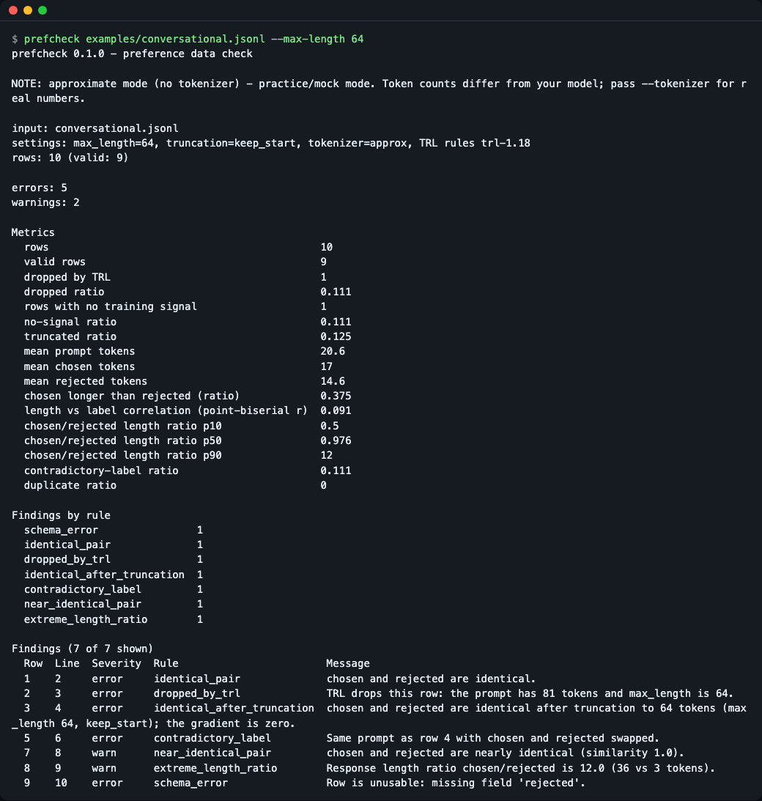
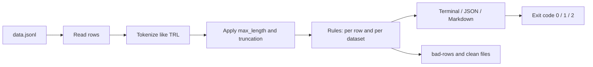
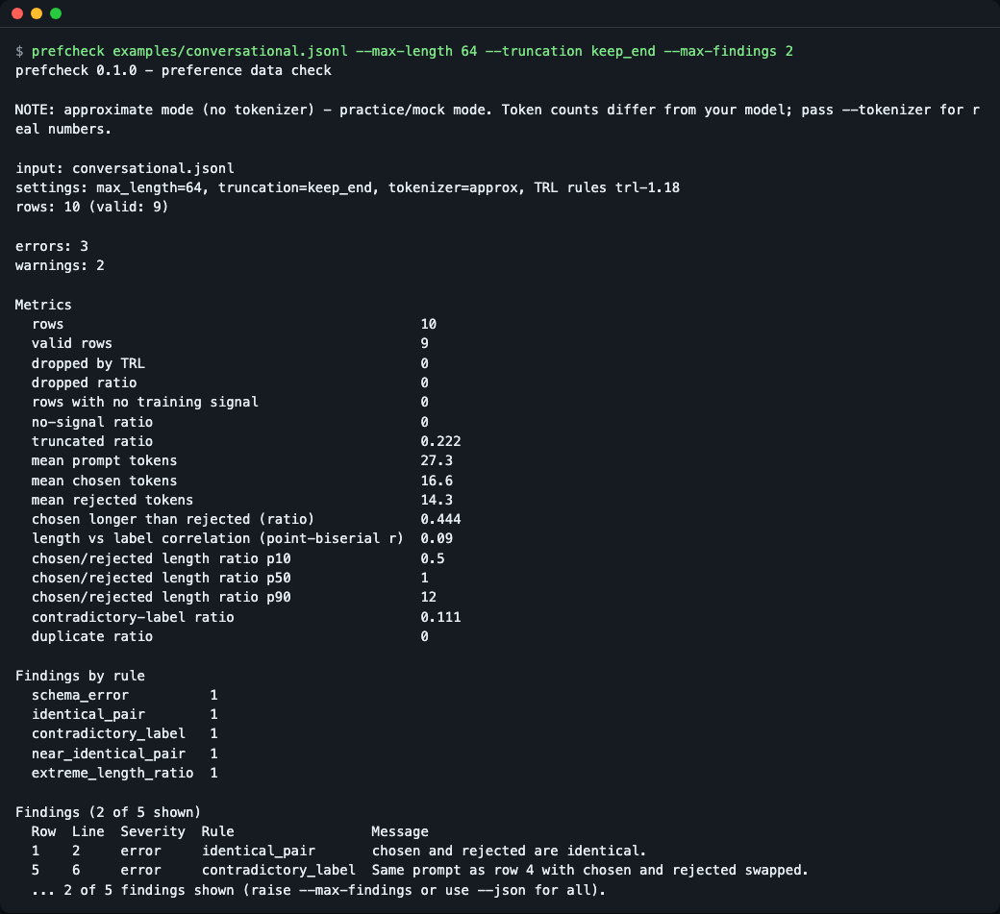
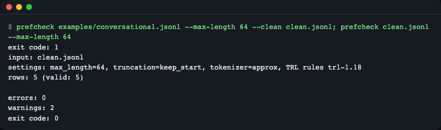
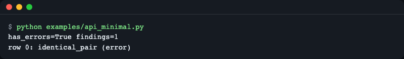

# prefcheck

**English** | [한국어](README.ko.md)

prefcheck lints DPO/ORPO preference datasets (JSONL or JSON) before you start training. It replays the way TRL prepares each pair (tokenizer, prompt boundary, `max_length`, truncation) and tells you, by row number, which rows would be silently dropped, which become identical after truncation, which contradict each other, and whether `chosen` is systematically longer than `rejected`. It works as a CLI and as a Python library, with no required dependencies.



*The report for the bundled sample file: 5 errors and 2 warnings, each with its row and line number. This run uses the practice (mock) mode described below.*

## Install

```bash
pip install prefcheck            # CLI + library, standard library only
pip install "prefcheck[hf]"      # adds transformers + tokenizers for your model's real tokenizer
```

With uv: `uv tool install prefcheck` (CLI) or `uv add prefcheck` (library). If you do not have uv yet: `curl -LsSf https://astral.sh/uv/install.sh | sh`. To install straight from the repository instead: `pip install "git+https://github.com/LeeGyeongPil/prefcheck"`.

Requires Python 3.11+. The core has zero runtime dependencies. The `[hf]` extra pins `transformers==5.23.0`, `tokenizers==0.23.3` and `jinja2==3.1.6`; PyTorch is not needed.

## Quick start

Try it on the sample files from a clone of this repository (this is the practice mock mode, no tokenizer needed):

```bash
git clone https://github.com/LeeGyeongPil/prefcheck && cd prefcheck
uv sync
uv run prefcheck examples/conversational.jsonl --max-length 64
```

Without `--tokenizer`, prefcheck uses an approximate word-and-punctuation tokenizer, so this is a **practice (mock) mode**: token counts will not match your model. The rule logic (drops, truncation, contradictions, length bias) is the real one. Pass `--tokenizer <model-id-or-folder>` for real numbers.

The output starts like this (shortened here; the screenshot above shows the whole report):

```text
prefcheck 0.1.1 - preference data check

NOTE: approximate mode (no tokenizer) - practice/mock mode. Token counts differ from your model; pass --tokenizer for real numbers.

input: conversational.jsonl
settings: max_length=64, truncation=keep_start, tokenizer=approx, TRL rules trl-1.18
rows: 10 (valid: 9)

errors: 5
warnings: 2
```

Near the end of the output is the findings table (with `--max-findings 3` a short hint line follows it):

```text
Findings (3 of 7 shown)
  Row  Line  Severity  Rule                        Message
  1    2     error     identical_pair              chosen and rejected are identical.
  2    3     error     dropped_by_trl              TRL drops this row: the prompt has 81 tokens and max_length is 64.
  3    4     error     identical_after_truncation  chosen and rejected are identical after truncation to 64 tokens (max_length 64, keep_start); the gradient is zero.
```

That run was `--max-findings 3`; by default up to 50 findings are shown. Row numbers start at 0 and line numbers at 1, so a row-1 finding is on line 2 of the file. The exit code is `1` here because there are errors.

## Core concepts

1. **TRL replay.** For each row prefcheck follows the preparation steps of TRL 1.18 (the `trl-1.18` profile): extract an implicit prompt, add EOS for plain-text data, tokenize, take the common token prefix as the prompt boundary, drop rows whose prompt alone fills `max_length` under `keep_start`, and truncate the completion with `keep_start` or `keep_end`. The settings you pass (`--max-length`, `--truncation`, `--tokenizer`) change the result, as in real training.
2. **One cause, one finding.** An identical pair is reported as `identical_pair` only, a dropped row skips the signal rules, and a row with a schema error skips the rest.
3. **Errors vs warnings.** Errors are problems that waste training or break a row (exit code 1). Warnings are worth a look (exit code 0 unless `--fail-on warn`). Dataset-wide rules, such as `length_bias`, describe the whole file.
4. **Practice mode vs real mode.** The approximate tokenizer only changes token counts. Near a boundary (a prompt of 62 vs 66 tokens at `max_length` 64), re-run with your real tokenizer.



Read it left to right: rows are tokenized the way the trainer would, cut to your settings, checked by the rules, and reported in several forms plus an exit code for CI.

### Data formats

Three shapes are accepted, one record per line (`.jsonl`) or as a `.json` array. Conversational rows have `prompt`, `chosen`, `rejected` as lists of `{"role", "content"}` messages. Standard rows have strings. Implicit-prompt rows have only `chosen` and `rejected`, where the shared start is the prompt. Samples: [`examples/conversational.jsonl`](examples/conversational.jsonl), [`examples/standard_implicit.jsonl`](examples/standard_implicit.jsonl).

## Usage

### Command line

```text
prefcheck [--tokenizer NAME|PATH] [--offline] [--revision REV]
          [--max-length N|none] [--truncation {keep_start,keep_end}]
          [--config PATH] [--json PATH] [--markdown PATH]
          [--bad-rows PATH] [--clean PATH] [--fail-on {error,warn,never}]
          [--max-findings N] [--lang {en,ko}] [--list-rules] [--version]
          [-h]
          [DATA]
```

| Option | What it does |
|---|---|
| `DATA` | `.jsonl` file or `.json` array of preference rows |
| `--tokenizer` | Hub model id or local folder (needs `prefcheck[hf]`). Omitted: approximate practice mode |
| `--offline` | Read the tokenizer from local files only and fail at once instead of retrying the network |
| `--revision` | Tokenizer branch, tag or commit |
| `--max-length N\|none` | The TRL `max_length` to simulate (default 1024) |
| `--truncation` | The TRL `truncation_mode` to simulate (`keep_start` default, or `keep_end`) |
| `--config` | A `prefcheck.toml` with thresholds and per-rule severities |
| `--json` / `--markdown` | Write a machine-readable or Markdown report |
| `--bad-rows` | Write rows with errors (the original row plus a `_prefcheck` field) |
| `--clean` | Write only the rows without errors, text and order unchanged |
| `--fail-on` | `error` (default), `warn` or `never`: which severity gives exit code 1 |
| `--max-findings N` | How many findings the terminal table shows (default 50) |
| `--lang en\|ko` | Screen language (see Settings) |
| `--list-rules` | Print every rule with its default severity |

Exit codes: `0` nothing at the failing severity, `1` findings at or above `--fail-on`, `2` usage or input error (for example a missing file: `prefcheck: error: File not found: nofile.jsonl. Check the path.`). An output path (`--json`, `--markdown`, `--bad-rows`, `--clean`) that equals the input file is refused with exit 2 so the input is never overwritten.

### Rules

`prefcheck --list-rules` prints all 13 (errors unless noted):

| Rule | Meaning |
|---|---|
| `schema_error` | The row is unusable: missing field, wrong type, empty text, bad role |
| `identical_pair` | `chosen` equals `rejected`, so there is no preference signal |
| `dropped_by_trl` | Under `keep_start` the prompt alone fills `max_length`, so TRL drops the row |
| `empty_completion_after_truncation` | No completion tokens are left after truncation |
| `identical_after_truncation` | Different text, but identical after a real truncation (loss 0.693, gradient 0). Rows that merely tokenize the same without any cut (for example, whitespace-only differences) are reported as `near_identical_pair` |
| `contradictory_label` | The same prompt appears elsewhere with `chosen` and `rejected` swapped |
| `prompt_not_prefix` (warn) | The tokenized prompt is not a prefix of prompt + response, so its end is lost in training |
| `near_identical_pair` (warn) | Normalized text is the same or nearly the same (character 3-gram Jaccard) |
| `extreme_length_ratio` (warn) | The response length ratio is extreme, so a model may learn length instead of quality |
| `duplicate_row` (warn) | Same prompt, `chosen` and `rejected` as an earlier row |
| `implicit_prompt_split` (warn) | An implicit prompt cannot be split cleanly from `chosen` and `rejected` |
| `mixed_format` (dataset) | Formats are mixed; TRL decides prompt extraction and EOS handling from the first row only |
| `length_bias` (warn, dataset) | `chosen` is systematically longer than `rejected` (a reference metric) |

### Output files for pipelines

```bash
prefcheck examples/conversational.jsonl --max-length 64 \
  --json report.json --markdown report.md --bad-rows bad.jsonl --clean clean.jsonl
```

`report.json` is language-neutral (rule ids and numbers; only `message` follows the chosen language) and starts with:

```json
{
  "meta": {
    "tool": "prefcheck",
    "tool_version": "0.1.1",
    "trl_rules": "trl-1.18",
    "mode": "approx",
    "tokenizer": "approx",
    "input": "conversational.jsonl"
  },
```

### Python API

```python
from prefcheck import CheckConfig, check_rows

rows = [
    {
        "prompt": [{"role": "user", "content": "What color is the sky?"}],
        "chosen": [{"role": "assistant", "content": "The sky is blue."}],
        "rejected": [{"role": "assistant", "content": "The sky is blue."}],  # identical pair: an error
    },
    {
        "prompt": [{"role": "user", "content": "Name a prime number."}],
        "chosen": [{"role": "assistant", "content": "Seven is a prime number."}],
        "rejected": [{"role": "assistant", "content": "Nine is a prime number."}],
    },
]

report = check_rows(rows, CheckConfig(max_length=64))
print(f"has_errors={report.has_errors} findings={len(report.findings)}")
for finding in report.findings:
    print(f"row {finding.row}: {finding.rule} ({finding.severity})")
```

```text
has_errors=True findings=1
row 0: identical_pair (error)
```

This is [`examples/api_minimal.py`](examples/api_minimal.py). Reading a file and changing the truncation mode:

```python
from prefcheck import CheckConfig, check_file

report = check_file("examples/conversational.jsonl", CheckConfig(max_length=64, truncation_mode="keep_end"))
print(report.has_errors, report.exit_code(), len(report.findings), report.stats["dropped_by_trl"])
f = report.findings[0]
print(f.row, f.line, f.rule, f.severity)
```

```text
True 1 5 0
1 2 identical_pair error
```

With `keep_end`, row 2 is no longer dropped and row 3 is no longer identical, so 5 findings remain instead of 7.

## Try it step by step

The commands below use bare `prefcheck`. Inside the clone from the Quick start, put `uv run` in front (or activate `.venv`); after `pip install` or `uv tool install`, run `prefcheck` directly.

**1. Change the truncation mode.** Run the same file with `--truncation keep_end`:

```bash
prefcheck examples/conversational.jsonl --max-length 64 --truncation keep_end --max-findings 2
```



*Errors drop from 5 to 3. The dropped row and the identical-after-truncation row disappear, because `keep_end` keeps the tail of the sequence. The training setting changes the verdict, which is the point of the tool.*

**2. Switch truncation off.** `--max-length none` removes every truncation-related finding (the report then shows `errors: 3`, `warnings: 2`, as no row is cut).

**3. Gate CI.** Write the clean rows, then check that file: it exits 0.

```bash
prefcheck examples/conversational.jsonl --max-length 64 --clean clean.jsonl
echo $?   # 1: the original has errors
prefcheck clean.jsonl --max-length 64
echo $?   # 0: no errors left (2 warnings remain)
```



*The first command exits with 1, the cleaned file with 0. Use `--fail-on warn` to make warnings fail too.*

In CI, run `prefcheck data.jsonl --max-length 1024 --tokenizer <your model>` and let the exit code fail the job.

## Library overview



*`examples/api_minimal.py` finds the identical pair in an in-memory dataset.*

| Name | What it does | Main arguments | Returns |
|---|---|---|---|
| `check_rows(rows, config=None, tokenizer=None)` | Check rows already in memory | iterable of dicts, `CheckConfig`, a tokenizer | `Report` (raises `InputFormatError` if no rows) |
| `check_file(path, config=None, tokenizer=None)` | Read a JSONL/JSON file and check it, findings carry line numbers | path | `Report` |
| `CheckConfig(max_length=1024, truncation_mode="keep_start", thresholds=..., severities={})` | What to simulate and how strict to be (`max_length=None` is no truncation; severities are `off`, `warn`, `error`) | see left | config; raises `ConfigError` for bad values |
| `Thresholds(near_identical_jaccard=0.9, length_ratio_max=4.0, length_bias_ratio=0.7, length_bias_r=0.3)` | Rule thresholds | see left | thresholds; raises `ConfigError` out of range |
| `load_tokenizer(name_or_path, *, offline=None, revision=None)` | Load a Hugging Face tokenizer (needs `prefcheck[hf]`) | model id or folder | `HFTokenizer`; raises `TokenizerLoadError` |
| `ApproxTokenizer`, `HFTokenizer`, `Tokenizer` | Approximate tokenizer, real tokenizer, and the protocol they follow | | |
| `Report` | `findings`, `stats`, `meta`, `config`; `has_errors`, `exit_code(fail_on)`, `count(severity)`, `count_by_rule()`, `to_dict(lang)`, `to_json(lang)`, `to_markdown(lang)`, `render_terminal(lang)` | | |
| `Finding` | One problem: `row` (0-based, `None` for dataset-wide), `line` (1-based, `None` for in-memory rows), `rule`, `severity`, `detail` | | |
| `RULES` | Mapping of rule id to rule info | | |
| `PrefcheckError` and `InputFormatError`, `TokenizerLoadError`, `ConfigError` | Errors raised on purpose | | |

Real tokenizer example (needs the `[hf]` extra and your model downloaded or cached):

```python
from prefcheck import CheckConfig, check_file, load_tokenizer

tokenizer = load_tokenizer("<your-model-id-or-local-folder>")
report = check_file("data.jsonl", CheckConfig(max_length=1024), tokenizer=tokenizer)
```

## Settings

- **Config file.** `prefcheck data.jsonl --config prefcheck.toml` reads [`examples/prefcheck.toml`](examples/prefcheck.toml): `[check]` (`max_length`, `truncation`), `[thresholds]`, and `[rules.<id>] severity = "off" | "warn" | "error"`. Running the sample with it gave `errors: 3`, `warnings: 1` (max_length 1024, `near_identical_pair` off, `length_bias` as error).
- **Language.** Screens are English or Korean. Order of precedence: `--lang en|ko`, then `PREFCHECK_LANG`, then `LC_ALL`, `LC_MESSAGES`, `LANG` (a value starting with `ko` selects Korean, anything else English). For example `PREFCHECK_LANG=ko prefcheck data.jsonl`.
  The Korean screenshots of every step are in [README.ko.md](README.ko.md).
- **Offline.** `--offline` (or `HF_HUB_OFFLINE=1`) reads the tokenizer from local files only.

## When to use it

- Good fit: you are about to start a DPO/ORPO run with TRL and want to know what your `max_length` and tokenizer do to the data, or you want a CI gate on a preference file.
- Not covered: it does not judge answer quality, check licenses or personal data, or cover other trainers' own preprocessing. For a general dataset viewer see [Hugging Face Datasets](https://huggingface.co/docs/datasets), and for the training itself see [TRL](https://huggingface.co/docs/trl/main/en/dpo_trainer).

## Limitations

- Practice mode token counts are approximate; near a boundary, re-run with `--tokenizer`.
- Replay follows TRL 1.18 (`trl-1.18`). Older preparation (such as `max_prompt_length`) is not modelled yet.
- With only 1 to 3 rows, `length_bias` can fire by chance; treat dataset-wide metrics on tiny files as a hint.
- The whole file is read into memory; very large files are not optimized yet.

## Troubleshooting

| Symptom | Cause | Fix |
|---|---|---|
| `Real tokenizer mode needs the optional dependencies...` | The `[hf]` extra is not installed | `pip install "prefcheck[hf]"` |
| `[transformers] PyTorch was not found...` on stderr | `transformers` notes that PyTorch is absent | Safe to ignore: only tokenizers are used |
| `prefcheck: error: File not found: ...` (exit 2) | Wrong path | Check the path |
| `--tokenizer` hangs or fails for a model id | No network or the model is not cached | Add `--offline` to fail fast, or pass a local folder |
| `Cannot read ...: it is not valid UTF-8 ...` (exit 2) | The file is not UTF-8 (for example UTF-16 saved on Windows) | Save it as UTF-8 JSONL and retry |
| Exit code 1 in CI although the data looks fine | An error-level rule fired | Read the findings, or lower a rule with `--config` |

## Versioning

This project follows [Semantic Versioning](https://semver.org/). While the version is 0.x, the API can change in a minor release; changes are listed in [CHANGELOG.md](CHANGELOG.md).

## Development

```bash
uv sync
uv run pytest -q      # 35 tests, no network, torch, GPU or API key
uv build
```

## Sources

- TRL DPO trainer docs: https://huggingface.co/docs/trl/main/en/dpo_trainer (checked 2026-11-15)
- TRL dataset formats: https://huggingface.co/docs/trl/main/en/dataset_formats (checked 2026-11-15)
- The silent `keep_start` filter: https://github.com/huggingface/trl/pull/6321 (checked 2026-11-15)
- Truncated pairs with no signal, not planned in TRL: https://github.com/huggingface/trl/issues/7693 (checked 2026-11-15)
- TRL trainer source: https://raw.githubusercontent.com/huggingface/trl/main/trl/trainer/dpo_trainer.py (checked 2026-11-15)

## License

MIT.
